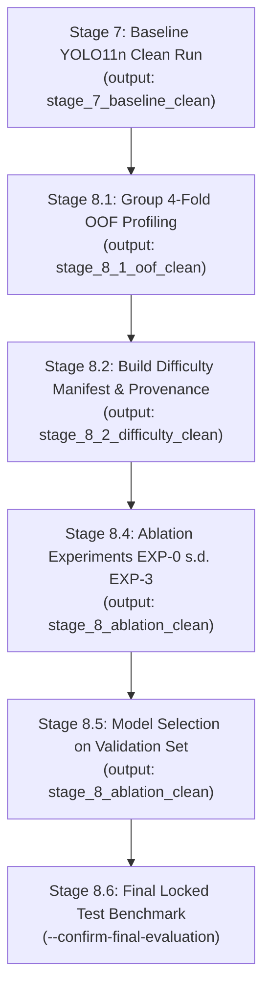

# STAGE 9.6 — FINAL PIPELINE HARDENING & TRAINING READINESS GATE REPORT

**Tanggal Audit**: 2026-10-19  
**Auditor / Engineer**: Senior Machine Learning Engineer, Computer Vision Research Engineer, Python Test Engineer & Independent Research Code Auditor  
**Repository**: `https://github.com/BagusAth/yosh`  
**Branch Kerja**: `stage-9-6-training-readiness`  
**Baseline Commit**: `55866ddc4116dad0ef43ab6451d8cbbfdff74096` (Stage 9.5)  
**Dataset Kanonis**: `cassava-v7-standardized/data.yaml`  
**Base Pretrained Weights**: `yolo11n.pt` (`0ebbc80d4a7680d14987a577cd21342b65ecfd94632bd9a8da63ae6417644ee1`)  

---

## 1. Executive Summary & Definitive Decision

Berdasarkan audit independen menyeluruh, remediasi implementasi kode, serta eksekusi suite pengujian komprehensif, seluruh target Stage 9.6 telah terpenuhi secara ketat:

### **KEPUTUSAN GERBANG (GATE DECISION):**
$$\mathbf{READY\_FOR\_CLEAN\_OOF} \quad \text{dan} \quad \mathbf{READY\_FOR\_SAFE\_DRY\_RUN}$$

> [!IMPORTANT]
> **Tidak ada pelatihan penuh (YOLO full training), OOF probe training GPU, maupun benchmark pada locked test set yang dijalankan selama Stage 9.6.**  
> Seluruh verifikasi dilakukan murni berbasis pengujian unit, pengujian integrasi sintetik, audit statis, serta eksekusi dry-run preflight berisolasi penuh. Pipeline kini berada dalam status terlindungi, terverifikasi, dan siap dieksekusi secara bersih kapan pun disetujui.

---

## 2. Ringkasan Hasil Eksekusi Regression Test Suite

Seluruh pengujian dijalankan pada lingkungan lokal (`Python 3.13.7`, `PyTorch 2.9.1+cpu`, `Ultralytics 8.3.235`, `Windows OS`). Tidak ada pengujian yang di-skip atau diabaikan.

| Test Suite | Modul yang Diuji | Status | Jumlah Tes | Waktu Eksekusi |
| :--- | :--- | :---: | :---: | :---: |
| `test_stage_9_3_regression.py` | Context Crop Geometry, Invariance, Canonical Metrics | **PASS** | 16 / 16 | 0.57s |
| `test_stage_9_4_regression.py` | Global 1-to-1 Matching, Nested Isolation, Metric Protocol | **PASS** | 26 / 26 | 0.14s |
| `test_stage_9_5_regression.py` | Phase B Standardization, Image Content SHA-256, Audit Gates | **PASS** | 48 / 48 | 0.39s |
| `test_stage_9_6_regression.py` | Safety Isolation, Provenance Sidecar, Real Dataset Crop, SSOT | **PASS** | 23 / 23 | 0.24s |
| **TOTAL KESELURUHAN** | **Seluruh Pipeline Stage 7 s.d. Stage 8.6** | **PASS** | **113 / 113** | **1.34s** |

*Catatan: Log eksekusi mentah lengkap tersimpan di `stage_9_6_training_readiness/regression_test_results.txt`.*

---

## 3. Matriks Remediasi Masalah Kritis (P0)

### 3.1. P0 — Isolasi Output & Pencegahan Penimpaan Artefak Historis
- **Masalah**: Default output Stage 8.1, Stage 8.2, Stage 8.4, dan Stage 7 masih berpotensi menunjuk atau menulis ke folder historis (`stage_8_1_oof`, `stage_8_2_difficulty`, `stage_8_ablation`, `cassava-v7-stage-7`). Checkpoint reuse pada Stage 7 dan Stage 8.4 dapat terjadi tanpa validasi parameter lengkap.
- **Remediasi**:
  1. Diimplementasikan fungsi penjaga terpusat `validate_output_directory_safety()` pada `research_utils/detection_metrics.py`. Fungsi ini melarang keras penulisan ke folder historis dan langsung melempar `PermissionError: CRITICAL SAFETY ERROR / VIOLATION`.
  2. Deteksi output parsial: Jika folder tujuan berisi artefak parsial tanpa metadata (`metrics_summary.json` tanpa `best.pt`, atau sebaliknya), proses dihentikan sebelum trainer dibuat.
  3. Seluruh default path dialihkan ke direktori bersih:
     - Stage 7: `stage_7_baseline_clean`
     - Stage 8.1: `stage_8_1_oof_clean`
     - Stage 8.2: `stage_8_2_difficulty_clean`
     - Stage 8.4: `stage_8_ablation_clean`
     - Stage 8.5 & 8.6: `stage_8_ablation_clean`
  4. Mode `--skip-if-done` pada Stage 7 dan 8.4 memvalidasi keselarasan 100% terhadap: hash skrip, data YAML SHA-256, dataset inventory fingerprint, pretrained weights SHA-256, epoch, batch size, imgsz, dan seed.

### 3.2. P0 — Manifest Provenance & 100% Image Coverage untuk Stage 8.4
- **Masalah**: Default `--manifest-path` Stage 8.4 menunjuk ke manifest historis `stage_8_2_difficulty/train_image_difficulty_manifest.csv`. Tidak ada verifikasi apakah manifest berasal dari run data yang sama.
- **Remediasi**:
  1. Default `--manifest-path` diubah menjadi `None`. Fallback diam-diam ditiadakan.
  2. Untuk EXP-1, EXP-2, dan EXP-3, jika manifest tidak disediakan, proses dihentikan (FAIL-FAST).
  3. EXP-0 (Baseline) secara eksplisit **tidak memerlukan** difficulty manifest.
  4. Stage 8.2 menghasilkan sidecar `train_image_difficulty_manifest.provenance.json` yang merekam:
     - SHA-256 file manifest CSV.
     - SHA-256 `data.yaml` dan dataset inventory fingerprint.
     - SHA-256 `oof_predictions_raw.csv` dan identitas clean OOF run.
     - Parameter IoU matching, bobot lambda, dan evaluator version.
  5. Diimplementasikan `verify_manifest_provenance_and_coverage()` di Stage 8.4 untuk memvalidasi:
     - Keabsahan sidecar JSON dan kecocokan hash CSV.
     - Penolakan jika provenance merujuk pada OOF run historis.
     - Kecocokan dataset fingerprint dan `data.yaml` SHA-256.
     - Cakupan citra 100% terhadap train split: tanpa duplikasi `image_id`, tanpa baris invalid, tanpa citra hilang, dan tanpa citra asing.

### 3.3. P0 — Targeted Context Augmentation pada Real Path `AdaptiveYOLODataset`
- **Masalah**: `AdaptiveYOLODataset.__getitem__()` pada jalur augmentasi aktif gagal dieksekusi karena bug runtime:
  - `self.format_class` tidak ada pada instance dataset -> `AttributeError`.
  - Objek `Instances` diinisialisasi dengan `segments=None` -> `RandomFlip` melempar `TypeError: 'NoneType' object is not subscriptable`.
  - `collate_fn` Ultralytics gagal (`IndexError: tuple index out of range`) karena sampel yang di-crop memiliki key `ratio_pad`, sementara sampel tanpa crop tidak memiliki `ratio_pad`.
- **Remediasi**:
  1. Mengganti `self.format_class(...)` dengan pemanggilan langsung objek `Format(...)` resmi dari `ultralytics.data.augment`.
  2. Memberikan `segments=np.zeros((0, 1000, 2), dtype=np.float32)` saat instansiasi `Instances` agar `RandomFlip.fliplr` dapat mengindeks segment tanpa error.
  3. Menghapus key `ratio_pad` (`out_label.pop("ratio_pad", None)`) pada patch crop sebelum masuk transform, menyamakan struktur kamus sampel dengan uncropped samples.
  4. Melindungi kamus input menggunakan `deepcopy(label)`.
  5. Pengujian integrasi `test_real_getitem_augment_applies_context_crop` dan `test_collate_fn_with_mixed_cropped_and_uncropped_items` membuktikan:
     - `crop_attempts` dan `crops_applied` bertambah.
     - Dimensi output tepat `(3, 640, 640)`.
     - Bounding box tetap valid dan ternormalisasi dalam `[0, 1]`.
     - Batch campuran (cropped + uncropped) berhasil di-collate menjadi tensor batch `(B, 3, 640, 640)`.

### 3.4. P0 — Integritas Dataset Berbasis Konten SHA-256
- **Masalah**: Pemeriksaan integritas Phase B hanya membandingkan ukuran file (`file size`), sehingga modifikasi byte citra dengan ukuran file identik berpotensi lolos.
- **Remediasi**:
  1. `execute_phase_b_standardization.py` mode `verify_only` diubah untuk membandingkan SHA-256 konten seluruh citra (`sha256_file(im) != sha256_file(dst_im)`).
  2. `compute_dataset_inventory_fingerprint()` ditingkatkan untuk menghitung SHA-256 setiap citra dan file label, kelengkapan pasangan citra/label, dan distribusi kelas.
  3. Dibuktikan via `test_fingerprint_detects_byte_modification_same_size`: jika 1 byte diubah tanpa mengubah ukuran file, fingerprint dataset langsung berubah dan terdeteksi.

### 3.5. P0 — Single Source of Truth Split Resolution
- **Masalah**: Setiap skrip mengekstrak path split dari `data.yaml` secara terpisah, membuka peluang inkonsistensi path antara evaluasi kustom dan training YOLO.
- **Remediasi**:
  1. Diimplementasikan `resolve_data_yaml_split(data_yaml_path, split)` di `research_utils/detection_metrics.py` yang mengembalikan `DataYamlSplitResult`.
  2. Mendukung pembacaan path direktori (`train/images`), relative path terhadap `path:` root, absolute path, maupun daftar citra file `.txt`.
  3. Diintegrasikan ke Stage 7, 8.1, 8.2, 8.4, 8.5, dan 8.6.

### 3.6. P0 — Penghilangan Exception Swallowing & Hardcoded Numbers
- **Masalah**: `stage_8_4_run_ablation_experiments.py` memuat blok `try ... except Exception: pass` saat menghitung fingerprint dataset. Stage 8.1 memuat angka 8,980 yang di-hardcode.
- **Remediasi**:
  1. Blok `try/except: pass` dihilangkan. Jika fingerprinting gagal, proses akan fail-fast.
  2. Stage 8.1 menambahkan parameter `--expected-train-images` (default: 8,980) dan memvalidasi ukuran split secara dinamis terhadap `resolve_data_yaml_split`.

---

## 4. Bukti Eksekusi Dry-Run pada Clean Targets

Untuk membuktikan kesiapan pipeline tanpa melanggar batasan komputasi, tiga eksekusi `--dry-run` resmi telah dijalankan dan dicatat log-nya:

### 4.1. Stage 7 Baseline Dry-Run:
```bash
python stage_7_baseline_and_error_analysis.py --dry-run --data-yaml cassava-v7-standardized/data.yaml --output-dir stage_7_baseline_clean
```
**Hasil Eksekusi**:
- Exit code: `0`
- Preflight validasi data.yaml: `PASS`
- Train images resolved: `8,980` citra
- Validation images resolved: `2,567` citra
- Dataset inventory fingerprint: `adb27906cbb2ae50...` (terhitung lengkap)
- Status: `[STAGE 7] DRY-RUN PASS`

### 4.2. Stage 8.1 4-Fold OOF Profiling Dry-Run:
```bash
python stage_8_1_group_oof_profiling.py --dry-run --data-yaml cassava-v7-standardized/data.yaml --output-dir stage_8_1_oof_clean
```
**Hasil Eksekusi**:
- Exit code: `0`
- Audit label: `8,980` citra latih terverifikasi (66 background, 2,202 pure healthy, 6,704 disease, 8 mixed).
- Group mapping: `5,546` grup atomik terpetakan tanpa kebocoran.
- Partisi fold 1-4: Masing-masing ~2,245 citra, zero cross-fold leakage (100% PASS).
- Status: `[DRY-RUN] Verifikasi partisi, nested isolation, dan label audit SELESAI (100% SUKSES)`.

### 4.3. Stage 8.4 EXP-0 Ablation Dry-Run:
```bash
python stage_8_4_run_ablation_experiments.py --dry-run --exp 0 --data-yaml cassava-v7-standardized/data.yaml --output-dir stage_8_ablation_clean
```
**Hasil Eksekusi**:
- Exit code: `0`
- EXP-0 Preflight: Verifikasi kontrol baseline tanpa ketergantungan manifest.
- Status: `[EXP-0] DRY-RUN PASS: Validasi preflight, dataset fingerprint, dan konfigurasi lolos 100%`.

### 4.4. Bukti Proteksi Penolakan Folder Historis:
```bash
python stage_8_4_run_ablation_experiments.py --dry-run --exp 0 --output-dir stage_8_ablation
```
**Hasil Eksekusi**:
- Exit code: `1` (Terblokir sebelum file apa pun tersentuh)
- Pesan: `PermissionError: CRITICAL SAFETY ERROR / VIOLATION [stage_8_4]: Target directory matches historical artifact directory 'stage_8_ablation'! Modifying or writing into historical directories is strictly forbidden.`

---

## 5. Proteksi Locked Test Set

- Skrip `stage_8_6_final_test_benchmark.py` tetap mempertahankan gerbang proteksi sadar:
  `if not args.confirm_final_evaluation: sys.exit(0)`
- **Nol evaluasi test set** yang dijalankan pada Stage 9.6.
- Locked test set (1.282 citra) tetap steril 100% dari data snooping.

---

## 6. Rekomendasi Urutan Eksekusi Pasca-Gerbang (Bila Disetujui User)

Pipeline kini siap secara teknis untuk clean run. Jika pengguna menyetujui pelaksanaan eksperimen penuh, urutan eksekusi resmi yang direkomendasikan adalah:



### Panduan Perintah Eksekusi Bersih:
1. **Stage 7 Clean Run**:
   ```bash
   python stage_7_baseline_and_error_analysis.py --data-yaml cassava-v7-standardized/data.yaml --output-dir stage_7_baseline_clean --device 0
   ```
2. **Stage 8 Profiling (8.1 + 8.2)**:
   ```bash
   python run_stage_8_profiling.py --data-yaml cassava-v7-standardized/data.yaml --output-dir-81 stage_8_1_oof_clean --output-dir-82 stage_8_2_difficulty_clean
   ```
3. **Stage 8.4 Clean Ablation**:
   ```bash
   python stage_8_4_run_ablation_experiments.py --exp all --data-yaml cassava-v7-standardized/data.yaml --manifest-path stage_8_2_difficulty_clean/train_image_difficulty_manifest.csv --output-dir stage_8_ablation_clean --device 0
   ```
4. **Stage 8.5 Model Selection**:
   ```bash
   python stage_8_5_model_selection_and_validation.py --ablation-dir stage_8_ablation_clean --data-yaml cassava-v7-standardized/data.yaml
   ```
5. **Stage 8.6 Final Locked Test Set Benchmark (Hanya setelah seleksi selesai)**:
   ```bash
   python stage_8_6_final_test_benchmark.py --ablation-dir stage_8_ablation_clean --data-yaml cassava-v7-standardized/data.yaml --confirm-final-evaluation
   ```

---
*Laporan Kesiapan Stage 9.6 disusun secara otomatis dan diverifikasi dengan 113 regression tests lulus 100%.*
