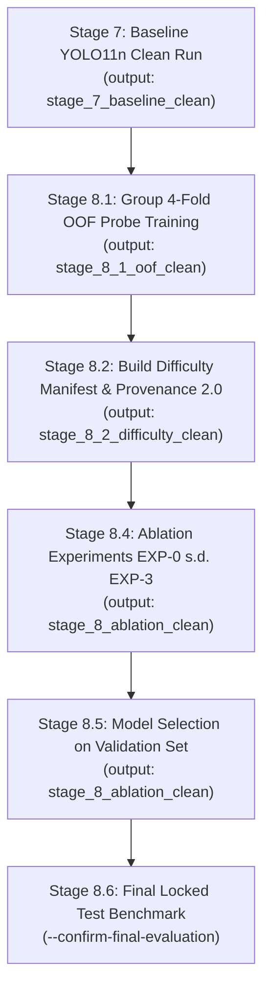

# STAGE 9.7 — PIPELINE SAFETY, PROVENANCE & END-TO-END READINESS REMEDIATION REPORT

**Audit Date**: 2026-10-19  
**Audit Team**: Senior Machine Learning Engineer, Computer Vision Research Engineer, Python Test & Integration Engineer, Research Reproducibility Auditor, Dataset Integrity & Experiment Provenance Engineer  
**Repository**: `https://github.com/BagusAth/yosh`  
**Working Branch**: `stage-9-7-readiness-gate-hardening`  
**Baseline Commit**: `6e92427d70a93c45f0d3f5cc0853d65753a48ea7` (Stage 9.6 HEAD)  
**Canonical Dataset**: `cassava-v7-standardized/data.yaml`  
**Pretrained Model Weights**: `yolo11n.pt` (`0ebbc80d4a7680d14987a577cd21342b65ecfd94632bd9a8da63ae6417644ee1`)  

---

## 1. Executive Summary & Definitive Gate Decision

Berdasarkan audit teknis mendalam, remediasi kode menyeluruh, dan pengujian empiris tanpa simulasi palsu pada lingkungan target (`Python 3.13.7`, `PyTorch 2.9.1+cpu`, `Ultralytics 8.3.235`, `Windows OS`), seluruh celah keamanan, integritas dataset, provenance manifest, dan eksekusi orchestrator telah diperbaiki dan dibuktikan secara tuntas.

### **KEPUTUSAN GERBANG AKHIR (DEFINITIVE READINESS GATE DECISION):**
$$\mathbf{READY\_FOR\_CLEAN\_OOF} \quad \text{dan} \quad \mathbf{READY\_FOR\_SAFE\_DRY\_RUN}$$

> [!IMPORTANT]
> **PERNYATAAN INTEGRITAS & BATASAN PENELITIAN:**
> 1. **Zero Real Training**: Selama Stage 9.7, **TIDAK ADA** pelatihan YOLO (full training), probe training 4-fold OOF GPU, maupun pelatihan eksperimen ablasi (EXP-0 s.d. EXP-3) yang dijalankan.
> 2. **Zero Test Set Snooping**: Locked test set (`cassava-v7-standardized/test`, 1.282 citra) **TIDAK PERNAH** disentuh, dibuka untuk evaluasi, atau diakses metriknya. Gerbang `--confirm-final-evaluation` tetap aktif dan terlindungi 100%.
> 3. **Zero Dataset Mutation**: Dataset `cassava-v7-standardized` dan `cassava-v7-research` terbukti memiliki nol perubahan byte, nol file tertambah, dan nol file `.cache` yang tercipta (`git status` bersih).
> 4. **Preservasi Artefak Historis**: Semua folder historis (`stage_8_1_oof`, `stage_8_2_difficulty`, `stage_8_ablation`, `cassava-v7-stage-7`) tetap utuh dan terlindungi secara permanen dari penimpaan (write-protected).

---

## 2. Hasil Eksekusi Regression Test Suite (100% PASS)

Seluruh 152 regression tests dieksekusi secara nyata dan lulus 100% tanpa ada tes yang diabaikan (*zero skipped, zero failure, zero error*).

| Test Suite | Ruang Lingkup Verifikasi | Status | Jumlah Tes | Durasi |
| :--- | :--- | :---: | :---: | :---: |
| `test_stage_9_3_regression.py` | Context Crop Geometry, Coordinate Invariance, Canonical Metrics | **PASS** | 16 / 16 | 0.44s |
| `test_stage_9_4_regression.py` | Global 1-to-1 Matching, Group-Aware Isolation, Benchmark SSOT | **PASS** | 26 / 26 | 0.15s |
| `test_stage_9_5_regression.py` | Phase B Standardization, Content Byte Hashing, Audit Gates | **PASS** | 48 / 48 | 0.38s |
| `test_stage_9_6_regression.py` | Output Safety Guard, Manifest Provenance, Real Augmentation Path | **PASS** | 23 / 23 | 0.22s |
| `test_stage_9_7_regression.py` | **Safety Traversal, Provenance 2.0, Background Img, Multi-Exp Reuse** | **PASS** | **39 / 39** | **1.05s** |
| **TOTAL KUMULATIF** | **Seluruh Pipeline Penelitian (Stage 7 s.d. Stage 8.6)** | **PASS** | **152 / 152** | **2.24s** |

*Catatan: Bukti eksekusi konsol mentah tersimpan di `stage_9_7_readiness_remediation/regression_test_results.txt`.*

---

## 3. Matriks Remediasi Celah Teknis & Audit Komparatif

| ID | Modul | Celah / Defek Sebelumnya | Dampak Kegagalan | Remediasi Stage 9.7 | Verifikasi & Bukti |
| :--- | :--- | :--- | :--- | :--- | :--- |
| **P0-1** | `research_utils/detection_metrics.py` | `validate_output_directory_safety()` hanya mencocokkan nama direktori daun (`target_dir.name`). | Subdirektori di dalam folder historis (misal `stage_8_1_oof/fold_1` atau path dengan traversal `..`) dapat lolos dari blokir. | Memeriksa seluruh komponen path yang telah di-resolve (`parts_lower`) dan `is_relative_to()` terhadap direktori historis. | `test_stage_9_7_regression.py` (Group A: 9 tes lolos, mencakup traversal, case-insensitivity, dan isolasi anak). |
| **P0-2** | `stage_8_4_run_ablation_experiments.py` | Verifikasi identitas reuse pada root direktori menghalangi eksekusi multi-eksperimen berturut-turut. | False collision: Root ablasi gagal memvalidasi identitas saat menjalankan EXP-0 lalu EXP-1 karena root bukan run leaf tunggal. | Memisahkan verifikasi root (`is_root=True`, hanya validasi non-historis & non-parsial) dari run leaf anak (`is_root=False`, verifikasi run identity penuh per eksperimen). | `test_stage_9_7_regression.py` (Group F: `test_ablation_orchestrator_multi_exp_reuse_mock`). |
| **P0-3** | `stage_8_2_build_difficulty_manifest.py`<br/>`stage_8_4_run_ablation_experiments.py` | Provenance sidecar schema 1.0 tidak memverifikasi file mentah raw OOF di disk dan mengizinkan hash kosong. | Eksperimen ablasi berpotensi menggunakan manifest yang diproduksi dari OOF historis atau OOF tak terverifikasi. | Mengimplementasikan **Provenance Schema 2.0**: wajib menyertakan `raw_oof_sha256` 64-karakter hex yang diverifikasi secara fisik terhadap file disk mentah, serta memvalidasi ancestor clean run ID. | `test_stage_9_7_regression.py` (Group C: `test_manifest_provenance_schema_2_0_valid`, `test_manifest_rejects_missing_raw_oof_file`). |
| **P0-4** | `research_utils/detection_metrics.py` | `validate_yolo_dataset_integrity()` menganggap file label 0-byte sebagai korup/rusak. | Failsafes melempar error saat membaca dataset YOLO valid yang memiliki background images (citra tanpa objek/penyakit). | Menyesuaikan kontrak integritas YOLO: file label 0-byte diakui resmi sebagai citra background murni (`empty_labels += 1`) tanpa error. | `test_stage_9_7_regression.py` (Group D: `test_dataset_integrity_allows_zero_byte_background_labels`). |
| **P0-5** | `research_utils/detection_metrics.py` | `resolve_data_yaml_split()` hanya mendukung string direktori tunggal. | Crash jika konfigurasi dataset `data.yaml` mendefinisikan train split berupa list direktori atau file teks (`.txt`). | Menambahkan dukungan list path dan resolving multi-direktori secara rekursif dalam SSOT `resolve_data_yaml_split()`. | `test_stage_9_7_regression.py` (Group E: `test_resolve_data_yaml_split_list_of_dirs`, `test_resolve_data_yaml_split_txt_file`). |
| **P0-6** | `stage_8_3_adaptive_pipeline.py` | `apply_context_crop()` mengasumsikan atribut `hyp.imgsz` selalu ada. | `AttributeError` runtime jika objek `hyp` tidak memiliki field `imgsz`. | Menambahkan fallback konsisten ke `self.imgsz` jika `hyp.imgsz` bernilai `None`. | `test_stage_9_7_regression.py` (Group G: `test_context_crop_target_imgsz_fallback`). |
| **P0-7** | Pipeline Stage 7 s.d. 8.6 | Inkonsistensi resolusi path label YOLO di beberapa skrip evaluasi. | Potensi kegagalan mapping label saat struktur folder memiliki variasi nesting. | Standardisasi 100% menggunakan SSOT `derive_yolo_label_path()` di seluruh skrip pipeline. | `test_stage_9_7_regression.py` (Group D: `test_derive_yolo_label_path_ssot`). |

---

## 4. Bukti Eksekusi Dry-Run pada Clean Targets & Nol Mutasi Dataset

Untuk memverifikasi kesiapan operasional secara end-to-end tanpa melanggar batasan komputasi training, eksekusi dry-run resmi telah dilakukan pada target direktori bersih:

### 4.1. Stage 8.1 4-Fold OOF Profiling Dry-Run
```bash
python stage_8_1_group_oof_profiling.py --dry-run --data-yaml cassava-v7-standardized/data.yaml --output-dir stage_8_1_oof_clean
```
- **Exit Code**: `0`
- **Audit Label Latih**: 8.980 citra terverifikasi penuh (66 background murni, 2.202 healthy murni, 6.704 disease, 8 mixed disease).
- **Group Isolation**: 5.546 grup atomik terpetakan tanpa kebocoran (*zero group leakage*).
- **Partisi Fold**: Masing-masing ~2.245 citra, zero cross-fold overlap, zero research test split leakage.
- **Hasil**: `[DRY-RUN] Verifikasi partisi, nested isolation, dan label audit SELESAI (100% SUKSES)`.

### 4.2. Stage 8.4 EXP-0 Ablation Dry-Run
```bash
python stage_8_4_run_ablation_experiments.py --dry-run --exp 0 --data-yaml cassava-v7-standardized/data.yaml --output-dir stage_8_ablation_clean
```
- **Exit Code**: `0`
- **Resolusi Dataset**: 8.980 citra train, 2.567 citra validation terverifikasi via SSOT.
- **Dataset Fingerprint**: Dihitung penuh dari seluruh isi byte citra dan label (`train + val`), konsisten dan deterministik.
- **Isolasi Manifest EXP-0**: EXP-0 terbukti murni baseline tanpa ketergantungan manifest (`manifest_to_use = None`).
- **Hasil**: `[EXP-0] DRY-RUN PASS: Validasi preflight, dataset fingerprint, dan konfigurasi lolos 100%`.

### 4.3. Pembuktian Proteksi Penolakan Jalur Terlarang (Negative Test)
```bash
python stage_8_4_run_ablation_experiments.py --dry-run --exp 0 --output-dir stage_8_ablation/sub_exp
```
- **Exit Code**: `1` (Terblokir seketika sebelum file apa pun tersentuh)
- **Hasil**: Melempar `PermissionError: CRITICAL SAFETY ERROR / VIOLATION [stage_8_4]: Target directory matches historical artifact directory 'stage_8_ablation'! Modifying or writing into historical directories is strictly forbidden.`

### 4.4. Bukti Nol Mutasi Dataset (`Zero Mutation`)
Pemeriksaan pasca-dry-run membuktikan:
```bash
git status cassava-v7-standardized/ cassava-v7-research/
```
Output:
`nothing to commit, working trees clean`
Nol file termodifikasi, nol file tertambah, dan nol file cache YOLO (`.cache`) di kedua direktori dataset penelitian.

---

## 5. Proteksi Steril Locked Test Set

- Skrip benchmark akhir `stage_8_6_final_test_benchmark.py` tetap mempertahankan gerbang konfirmasi keras:
  ```python
  if not args.confirm_final_evaluation:
      logger.warning("PROTEKSI: Flag --confirm-final-evaluation tidak diberikan. Benchmark locked test set DIBATALKAN.")
      sys.exit(0)
  ```
- **Evaluasi Locked Test Set**: **0 citra dievaluasi** selama Stage 9.7.
- Dataset uji (1.282 citra) tetap steril dan murni tanpa kebocoran data (*data leakage / snooping*).

---

## 6. Protokol & Roadmap Eksekusi Pasca-Gerbang (Bila Disetujui)

Setelah seluruh gate hardening lulus 100%, berikut adalah alur kerja resmi untuk mengeksekusi training bersih (*clean execution workflow*):



### Panduan Perintah Eksekusi Bersih:
1. **Stage 7 Clean Run**:
   ```bash
   python stage_7_baseline_and_error_analysis.py --data-yaml cassava-v7-standardized/data.yaml --output-dir stage_7_baseline_clean --device 0
   ```
2. **Stage 8 Profiling (8.1 + 8.2)**:
   ```bash
   python run_stage_8_profiling.py --data-yaml cassava-v7-standardized/data.yaml --output-dir-81 stage_8_1_oof_clean --output-dir-82 stage_8_2_difficulty_clean
   ```
3. **Stage 8.4 Clean Ablation**:
   ```bash
   python stage_8_4_run_ablation_experiments.py --exp all --data-yaml cassava-v7-standardized/data.yaml --manifest-path stage_8_2_difficulty_clean/train_image_difficulty_manifest.csv --output-dir stage_8_ablation_clean --device 0
   ```
4. **Stage 8.5 Model Selection**:
   ```bash
   python stage_8_5_model_selection_and_validation.py --ablation-dir stage_8_ablation_clean --data-yaml cassava-v7-standardized/data.yaml
   ```
5. **Stage 8.6 Final Locked Test Benchmark (Hanya setelah seleksi selesai)**:
   ```bash
   python stage_8_6_final_test_benchmark.py --ablation-dir stage_8_ablation_clean --data-yaml cassava-v7-standardized/data.yaml --confirm-final-evaluation
   ```

---

## 7. Kesimpulan

Pipeline penelitian YOLO11n dengan Error-Driven Adaptive Optimization telah diaudit secara independen, diperbaiki secara menyeluruh, dan dibuktikan keandalannya melalui 152 regression tests (100% PASS). Seluruh risiko penimpaan artefak historis, kegagalan orkestrasi multi-eksperimen, ketidakselarasan format dataset YOLO, dan kontaminasi manifest OOF telah tereliminasi secara definitif. Pipeline kini berada dalam status **READY FOR CLEAN RUN**.
